<div align="center">

<picture>
  <source media="(prefers-color-scheme: dark)" srcset="assets/banner-dark.svg">
  <source media="(prefers-color-scheme: light)" srcset="assets/banner-light.svg">
  
</picture>

[](https://github.com/iboshka24)
[](https://github.com/iboshka24?tab=followers)


</div>

## whoami

```ts
const iboshka24 = {
  alias: "iboshka24",
  role: "AI developer",
  city: "Tashkent",
  os: ["CachyOS", "Arch (by hand)", "Hackintosh · OpenCore", "Windows (for games)"],
  stack: ["TypeScript", "Next.js", "Python", "Rust", "Kotlin", "PostgreSQL"],
  worksWith: ["Hermes Agent", "DeepSeek", "Neovim", "Git"],
  philosophy: "a system is a list of decisions someone made — you can read them",
  building: ["VendraCode", "Vendra Teach", "Palmier Pro Linux"],
  examBank: "287K+ questions",
  buildingFor: "students anywhere — the tools are free, the borders are not the point",
  favouriteThing: "an agent proving a claim I doubted",
} as const;
```

## What I'm about

I build the tools I miss instead of waiting for someone to make them. Most of what's
here started as *"this should exist, so I'll write it"* — and lately that means
products with a model inside them, not a demo with a model next to them.

**Models as colleagues, not autocomplete.** [Hermes Agent](https://hermes-agent.nousresearch.com)
(an autonomous agent by Nous Research) running **DeepSeek** models keeps my servers up,
rebuilds the question bank, runs the tests and brings back evidence. I decide what gets
built; the agent does the long mechanical parts — and it is expected to prove its work
rather than announce success.

**Everything I build has AI inside it, not AI written on it.** Error explanations that
name the actual mistake. A workout plan that respects a knee. A SQL trainer that compares
your result to the reference instead of comparing text. An IDE where local agents share
one session instead of each editing a private copy. The model is a part of the product,
not a sticker on it.

**The layer under the layer.** Sometimes that is Linux and a Hackintosh, sometimes an
installer, sometimes a driver that refused to load. One of those evenings became
[ShobikaOs](https://github.com/iboshka24/ShobikaOs) — an Arch-based distribution with a
Rust/GTK4 installer, automatic driver detection and an ISO built on every push.

**Code that has to be right.** Mostly TypeScript and Python, but what I actually enjoy
is the part where the data structure decides whether the feature is even possible.
I would rather spend an evening designing the shape of a record than a week patching
around a bad one.

**Building for people everywhere.** A lot of students prepare for exams with
photocopied pages, no answer keys and no feedback. I grew up around that, so the
biggest thing I build is free exam practice — with real explanations, not just a
score. It started in Uzbekistan and is not meant to stay there.

## How I work

- **Local-first, user space.** The whole platform runs without root and without
  Docker: PostgreSQL, Valkey and the API are extracted into my home directory and
  started as normal processes. It means I can run the real stack on a laptop that
  never asked permission from anyone.
- **Tests before claims.** The question bank has a test that recomputes every answer
  from its own prompt, independently of the code that generated it. If the explanation
  and the key disagree, the build fails — I would rather know than ship a wrong answer
  to a student.
- **AI as a colleague, not autocomplete.** I work with **[Hermes Agent](https://hermes-agent.nousresearch.com)**
  driving **[DeepSeek](https://deepseek.com)** models: it runs my servers, regenerates the bank,
  writes and runs the tests, takes screenshots of the UI and reports back with evidence.
  I decide what gets built and what gets shipped.
- **Nothing invented.** Every number in a README of mine is measured: question counts
  come from the generated bank, star counts from GitHub, timings from real runs.

## Now

- **[VendraCode](https://github.com/iboshka24/VendraCode)** — a multiplayer IDE where local agents share one session: live edits, file locks, Mission Control.
- **[Palmier Pro Linux](https://github.com/iboshka24/palmier-pro-linux)** — Qt 6 video editor for Linux: 53 MCP tools, transform, color and effects through FFmpeg.
- **Vendra Teach** — 287K+ questions in the bank. The model should tell a student what they mixed up, not just "wrong".
- **Forma** — the Telegram app already runs the workout engine. Next is a meal from a photo into the diary.
- **[kod](https://github.com/iboshka24/kod)** — growing from a SQL trainer toward a course.

## Selected work

### Agents and editors

| | |
| --- | --- |
| **[VendraCode](https://github.com/iboshka24/VendraCode)** | Multiplayer AI-native IDE. Local agents — OpenCode, Claude Code, Cline, Antigravity CLI — share one session over `brain.vendra.uz`: live edits, advisory file locks, Mission Control, and a Telegram bot bound to an agent. Electron, React, TypeScript. |
| **[palmier-pro-linux](https://github.com/iboshka24/palmier-pro-linux)** | Native Qt 6 / PySide6 video editor for Linux. 53 MCP tools, transform, color and effects rendered through FFmpeg, dark theme. GPLv3. An improved Linux port of Palmier Pro — not a 1:1 copy of the macOS app. |
| **[kadr](https://github.com/iboshka24/kadr)** | One video, one project: from the idea to an mp4 with sound and subtitles — script, prompts, voice, edit — on a free stack. |
| **[effectcraft-mcp](https://github.com/iboshka24/effectcraft-mcp)** | MCP-enabled fork of [storytold/effectcraft](https://github.com/storytold/effectcraft) — open-source motion graphics and compositing, written in Rust. |
| **[filmcraft-mcp](https://github.com/iboshka24/filmcraft-mcp)** | MCP-enabled fork of [storytold/filmcraft](https://github.com/storytold/filmcraft) — open-source nonlinear video editor, written in Rust. |

### Learning

| | |
| --- | --- |
| **Vendra Teach** <sub>private</sub> | Exam practice for Digital SAT, IELTS, Milliy sertifikat and AP. **287K+** questions in the bank. Scheduled review of mistakes, timed exam mode. |
| **[kod](https://github.com/iboshka24/kod)** | Free SQL trainer. A real database in the browser; tasks are checked by result, not by text. SQLite in WebAssembly lives in the repo — no CDN, no build. [Live](https://kod-gamma.vercel.app). |
| **[wordloop](https://github.com/iboshka24/wordloop)** | Bilingual flashcard loop: paste words, the model filters and translates, then an infinite recall loop with spaced repetition. [Live](https://wordloop-three.vercel.app). |
| **[exam-figure-svg](https://github.com/iboshka24/exam-figure-svg)** | Exam figures — lines, parabolas, scatter plots, tables — from data straight to print-ready SVG. No dependencies, and no input can produce `NaN`. |
| **[spaced-repetition-queue](https://github.com/iboshka24/spaced-repetition-queue)** | Answers *"when should this question come back?"* — spaced repetition in about 200 lines, with tests. |

Both open packages above were extracted from Vendra Teach. They are what already runs there, cleaned up enough for someone else to use.

### Body, systems, site

| | |
| --- | --- |
| **[nutrition-math](https://github.com/iboshka24/nutrition-math)** | Calories and macros from your own body data. Mifflin–St Jeor, a deficit that refuses to go below 1500 kcal, warnings instead of silent compliance. 9 tests, zero dependencies. |
| **[workout-plan](https://github.com/iboshka24/workout-plan)** | A week of training from your days, minutes and equipment. A knee removes lunges, a back removes deadlifts, and each removed move gets a replacement. 10 tests. The same engine runs in Forma. |
| **[ShobikaOs](https://github.com/iboshka24/ShobikaOs)** | Arch-based Linux distribution: Rust/GTK4 installer, automatic driver detection, PipeWire, gaming tuning, an ISO on every push. |
| **[portfolio](https://github.com/iboshka24/portfolio)** | The site: whoami, projects, stack. Same colors as this page — graphite, orange, lime. Static, no build. [iboshka24.vercel.app](https://iboshka24.vercel.app). |

Also [Staff-utility](https://github.com/iboshka24/Staff-utility) (Paper/Folia server commands), [simple-galaxy-simulation-by-ai](https://github.com/iboshka24/simple-galaxy-simulation-by-ai), and the smaller experiments **klyro**, **opencode-studio**, **3d**.

## Stack


TypeScript and Next.js for anything with a screen, Electron when it has to be a desktop IDE, Python for anything that thinks, Rust when the installer has to be small and fast, Kotlin and Java when Minecraft is involved, Qt when the editor is a Linux port, PostgreSQL for the data that has to survive.

## Machines


CachyOS with KDE on Wayland is what I actually work on. Arch by hand and a Hackintosh
build are what I do when I want to remember how the pieces fit.

## Ask me about

Designing a question bank that can't lie about its own answers, putting a model inside
a product instead of next to it, and making study material free for students who can't
pay for it. Also a shared session for local coding agents, and Linux installs that went
wrong and how I got them back.

---

<p align="center">
  <picture>
    <source media="(prefers-color-scheme: dark)" srcset="https://github-readme-stats.vercel.app/api?username=iboshka24&amp;show_icons=true&amp;hide_border=true&amp;bg_color=0f1412&amp;title_color=ff6a1f&amp;text_color=eef3ea&amp;icon_color=c7f94e">
    <source media="(prefers-color-scheme: light)" srcset="https://github-readme-stats.vercel.app/api?username=iboshka24&amp;show_icons=true&amp;hide_border=true&amp;bg_color=f7f4ee&amp;title_color=c2410c&amp;text_color=17201c&amp;icon_color=3a6410">
    
  </picture>
  <picture>
    <source media="(prefers-color-scheme: dark)" srcset="https://github-readme-stats.vercel.app/api/top-langs/?username=iboshka24&amp;layout=compact&amp;hide_border=true&amp;bg_color=0f1412&amp;title_color=ff6a1f&amp;text_color=eef3ea">
    <source media="(prefers-color-scheme: light)" srcset="https://github-readme-stats.vercel.app/api/top-langs/?username=iboshka24&amp;layout=compact&amp;hide_border=true&amp;bg_color=f7f4ee&amp;title_color=c2410c&amp;text_color=17201c">
    
  </picture>
</p>

<p align="center"><sub>Most of the work still lives in a private repository, so the public graph is the small part. Open to talking about AI, agents and EdTech — and to pull requests in any package above.</sub></p>

<p align="center">
  <a href="https://iboshka24.vercel.app">Сайт</a> ·
  <a href="https://github.com/iboshka24/portfolio">Репозиторий сайта</a> ·
  <a href="https://github.com/iboshka24?tab=repositories">Все репозитории</a>
</p>
